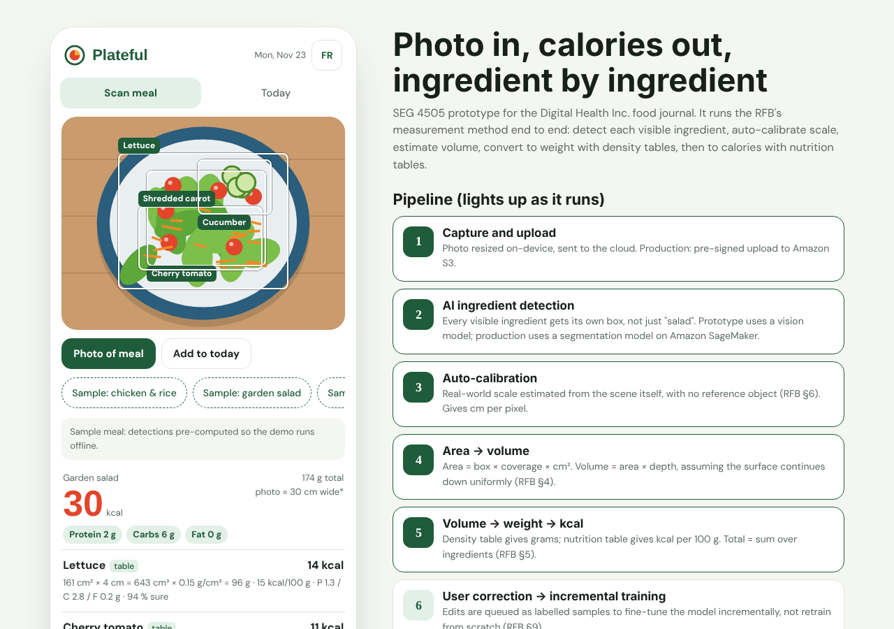

# Plateful: photo-based food journal prototype

**SEG 4505: Software Project Management, Fall 2026. Group 10**
Melanie Malek · Henry Saber · Michael Haddad · Mathew Aoun

Prototype for the Digital Health Inc. RFB (personal food journal application). You take one photo of a meal, and the app detects every visible ingredient, auto-calibrates the real-world scale without a reference object, then estimates volume, weight, calories and macros for each ingredient.



## Run it

No build step and no dependencies.

```bash
# Option 1: open the file directly
open index.html            # or double-click it

# Option 2: local web server (recommended)
npm start                  # serves on http://localhost:8080
# or: python3 -m http.server 8080
```

Run the unit tests (Node 18+):

```bash
npm test
```

**Website:** https://mathewaoun.github.io/plateful-prototype/ (app only). The full explanation page for the presentation is at `/details.html`.

**Live demo (with live AI detection):** see the hosted Claude artifact link shared by the team. Real photos are analysed on the website once the `analyze-meal` server function is deployed (see below). The three sample meals work without it.

## Backend: accounts and database

The app uses **Supabase** (a hosted PostgreSQL database with built-in user accounts) as its backend:

- **Sign up / log in / log out / forgot password** with email and password (Supabase Auth). Sessions persist across reloads.
- **Tables** (`supabase/schema.sql`): `profiles` (name, daily goal, language, training consent), `meals` (every logged meal with macros, ingredients and a thumbnail), `corrections` (user edits: the labelled data for incremental training, FR5).
- **Row-level security:** each user can only read and change their own rows, enforced by the database.
- **Offline (H13):** meals logged without a connection are queued and synced automatically when it returns.
- If `js/config.js` has no project URL and key, the app falls back to "demo mode" and saves in the browser only.

In production this layer maps to **API Gateway + Cognito + DynamoDB** on the client's existing AWS account (charter H8). The app code only talks to `js/db.js`, so swapping the backend doesn't touch the rest of the app.

### Setting up the database (once)

1. In Supabase, open **SQL Editor → New query**, paste `supabase/schema.sql`, and click **Run**.
2. **Authentication → Sign In / Providers → Email:** turn off **Confirm email** so new users get in immediately.
3. **Authentication → URL Configuration:** set **Site URL** to `https://mathewaoun.github.io/plateful-prototype/` so password-reset links come back to the app.
4. Put the Project URL and the publishable (anon) key in `js/config.js`. Both are safe to publish; never use the secret/service_role key in the app.

To show stored data in the demo: Supabase → **Table Editor → meals**.

### Real photo analysis (server function)

Real photos are analysed by the `analyze-meal` Supabase Edge Function (`supabase/functions/analyze-meal/index.ts`). It accepts photos only from signed-in users, sends them to Google Gemini's vision model, and returns every visible ingredient with its box, coverage, depth and food values. The app then runs the same measurement pipeline (`js/calc.js`). The AI key is stored as a server secret and never reaches the browser.

1. Get a free Gemini API key at aistudio.google.com (**Get API key → Create API key**).
2. Supabase → **Edge Functions → Deploy a new function → Via Editor**, name it `analyze-meal`, paste `index.ts`, click **Deploy**.
3. Supabase → **Edge Functions → Secrets**: add `GEMINI_API_KEY` = your key. Optional: `GEMINI_MODEL` to choose a specific model.

Note: on Gemini's free tier, Google may use submitted content to improve its products, so use test meals in the demo. Production replaces this with the team's own segmentation model on SageMaker.

## The app

- **Intro** on first visit: three swipeable screens, then you set a daily calorie goal.
- **Today:** a calorie ring (goal, eaten, burned from the tracker), protein/carbs/fat bars, and today's meals with photo thumbnails, grouped as breakfast, lunch, snack and dinner.
- **Scan** (big centre button): take or upload a photo, or try a sample meal. Ingredients are boxed one by one and the calories count up. Tap any ingredient to correct it, then log the meal in one tap.
- **Week:** a bar chart against your goal, with daily average, days on target and logging streak. Earlier days are sample data so the chart isn't empty.
- **Profile:** daily goal, training consent, training queue, API payload, replay intro, reset.
- **French / English** toggle in the top bar.

## What the demo shows

| Charter | Requirement | Where to see it |
|---|---|---|
| FR1 | Detect every visible ingredient | Salad sample: lettuce, cherry tomato, carrot and cucumber are detected separately |
| FR2 | Auto-calibration, no reference object | Photo width in cm shown for each scan |
| FR3 | Area → volume → weight → kcal, summed | Formula line under each ingredient |
| FR4 | Uniform distribution below the surface | Bean soup sample: the beans' share of the surface is applied to the full depth |
| FR5 | Incremental training | Corrections go into a training queue (Profile), only with user consent |
| FR6 | History and correction | Tap an ingredient to rename it, fix its weight or remove it; Today and Week keep the history |
| O1, O2 / R1 | Accuracy targets | Confidence for each ingredient; below 75 % it is flagged for the user to check |
| O3 | Analysis ≤ 5 s | Measured time shown on every live scan |
| O5 | ≤ 3 interactions | Photo → Log meal = 2 taps |
| O6 | Android and iOS | Mobile-first UI; the file input opens the camera on phones |
| H13 | Offline | Photo is queued offline and analysed on reconnect |
| H14 | French and English | FR/EN toggle |
| H15 | API to expenditure products | JSON payload on the Profile screen |
| Scope | Nutritional value | Protein, carbs and fat for each ingredient and meal |
| NFR | Consent for training data | Checkbox on the Profile screen |

## How the calculation works

`js/calc.js` (pure functions, unit-tested):

```
photo area (cm²)    = calibrated width × (width / aspect ratio)
ingredient area     = box width × box height × coverage × photo area
volume (cm³)        = area × depth      (surface assumed to continue uniformly to the bottom)
weight (g)          = volume × density  (density table)
kcal, P, C, F       = weight / 100 × values per 100 g (nutrition table)
meal total          = sum over ingredients
```

If the user corrects a weight, the correction replaces the estimate. If a food isn't in the reference table, the model's own density and nutrition estimates are used, and the item is tagged "AI est.".

## Project structure

```
index.html          the app only (this is the website's home page)
details.html        app + "how it works" panel: pipeline, AWS architecture, requirements, alternatives, competitors
css/styles.css      styles, light and dark mode
js/data.js          UI strings (EN/FR), food reference table, sample meals
js/calc.js          measurement pipeline (area → volume → weight → kcal)
js/config.js        Supabase project URL + publishable key
js/db.js            data layer: accounts, profiles, meals, corrections, offline queue
js/vendor/          supabase-js browser build (bundled, no CDN needed)
supabase/schema.sql database tables, security rules and sign-up trigger
supabase/functions/analyze-meal/  server function for real photo analysis (Gemini vision)
js/app.js           app shell (intro, Today, Scan, Week, Profile), live AI detection, journal, consent, API payload, offline queue
tests/calc.test.js  unit tests for the pipeline (node:test, no dependencies)
docs/               screenshots
```

## Prototype vs production

| Part | Prototype | Production (project plan) |
|---|---|---|
| Detection | Gemini vision model via a Supabase Edge Function, returning bounding boxes | Ingredient segmentation model trained on public food datasets, on Amazon SageMaker |
| Calibration | Scene-based estimate | Distance-estimation method [3] using camera data |
| Area | Box × coverage fraction | Pixel-exact segmentation masks |
| Food tables | ~45 typical reference values | Canadian Nutrient File (H4) + density database |
| Storage and accounts | Supabase (PostgreSQL + Auth, row-level security) | Cognito + DynamoDB + S3, encrypted at rest and in transit |
| Processing | In the page | API Gateway → S3 → SQS → SageMaker → Lambda, auto-scaling on the client's existing AWS |
| Mobile | Responsive web app | Flutter app for Android and iOS |

## Known limitations

- Salt, oil, butter and seasoning can't be seen in a photo, so they aren't counted (accepted in the RFB).
- The sample meals are illustrations with pre-computed detections. They demonstrate the pipeline, not detection accuracy.
- Reference values are typical figures for the prototype, not the Canadian Nutrient File.
- The calories-burned figure and the earlier days in the Week chart are sample data.
